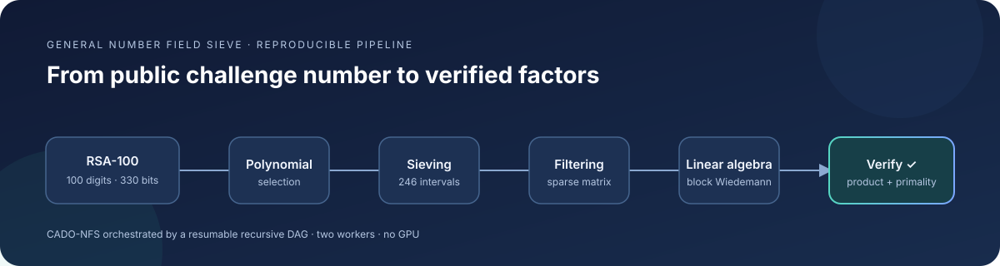

<div align="center">
  
  <br>
  <h1>CADO-NFS · RSA-100</h1>
  <p><strong>A verified, end-to-end GNFS reproduction on a small CPU-only machine.</strong></p>
  <p>
    <a href="https://github.com/AHMADALIPARR/CADO-RSA-100"></a>
    
    
    
    
  </p>
</div>

> **The result:** RSA-100 was factored in **5,632 seconds (93.9 minutes)** on a Linux VM with **1.5 shared CPUs, about 6 GB RAM, and no GPU**. The two recovered factors multiply to the target exactly, pass deterministic primality checks, and match the factors published in 1991. This is a reproduction of known public research—not a new factoring record.

## At a glance

| | Run details |
|---|---|
| Target | RSA-100 · 100 decimal digits · 330 bits |
| Method | General Number Field Sieve (GNFS), using [CADO-NFS](https://gitlab.inria.fr/cado-nfs/cado-nfs) |
| Orchestration | `dag.py`, a resumable recursive DAG driver |
| Successful wall time | **5,632 s / 93.9 min** |
| Sieving | **6,776,932 relations** across **246 q-intervals** |
| Machine | Linux VM · 1.5 shared CPUs · ~6 GB RAM · no GPU |
| Verification | Exact multiplication, deterministic Miller–Rabin, comparison with published factors |
| Status | Complete; verified reproduction |

## The verified result

The public RSA-100 challenge integer is:

```text
1522605027922533360535618378132637429718068114961380688657908494580122963258952897654000350692006139
```

Its factors are:

```text
37975227936943673922808872755445627854565536638199
40094690950920881030683735292761468389214899724061
```

Each factor is 50 digits. The run verifies that their product equals RSA-100 exactly and that both factors are prime. These are the factors first published in 1991; the project reproduces a known result.

## How it works

`dag.py` represents the GNFS workflow as dependent stages and expands stages into parallel task groups when useful. It invokes CADO-NFS tools directly; it does not rewrite CADO-NFS.

| Stage | What happens |
|---|---|
| Polynomial | Uses CADO-NFS's shipped `c100.poly` for the target run |
| Factor base & free relations | Prepares data needed by the sieve |
| Sieving | Runs independent q-interval tasks; resumes from existing relation files and adds work until enough relations are available |
| Filtering | Deduplicates and filters relations; estimates and sieves additional relations if purge needs them |
| Linear algebra | Uses CADO-NFS block Wiedemann (`bwc.pl`) |
| Square root | Tests kernel dependencies to recover factors |
| Verification | Independently checks the product and primality before accepting the result |

Independent tasks run in parallel, with two workers in the documented run. Outputs and logs are kept in the work directory so a run can resume from completed work. See [`DAG.md`](DAG.md) for the DAG structure and [`PAPER.md`](PAPER.md) for the full methods and measurements.

## Reproduce the run

### Requirements

A Linux environment with Python 3, C/C++ build tools, CMake, and GMP development files. The documented environment used Python 3.12, CMake 3.28.3, GCC/G++ 13.3.0, and `make -j2`. Resource use and run time depend heavily on the machine.

### Build CADO-NFS

```bash
git clone https://gitlab.inria.fr/cado-nfs/cado-nfs.git
cd cado-nfs
git checkout 692ecb7e62f0f3bdab88ee44cc60b8ded0ea1a1b
make -j2
```

### Run the RSA-100 DAG

From this repository, replace `<CADO_NFS>` with the CADO-NFS checkout path and `<BUILD_HOST>` with the build directory name (for example, `htch-runtime`):

```bash
python3 dag.py \
  --params <CADO_NFS>/parameters/factor/params.c100 \
  --n 1522605027922533360535618378132637429718068114961380688657908494580122963258952897654000350692006139 \
  --workdir work/rsa100 \
  --bindir <CADO_NFS>/build/<BUILD_HOST> \
  --threads 2 \
  --poly <CADO_NFS>/parameters/polynomials/c100.poly
```

The `--poly` argument selects CADO-NFS's supplied polynomial for the c100 parameters and skips the expensive polynomial-selection stage. Re-running the command with the same work directory resumes from outputs already present. The completed run's factor and verification files are `work/rsa100/factors.txt` and `work/rsa100/verify.txt` (the large intermediate work data is not included in this repository).

## Repository guide

| Path | Contents |
|---|---|
| [`dag.py`](dag.py) | Recursive DAG orchestration driver |
| [`DAG.md`](DAG.md) | Pipeline stages, sub-DAGs, and execution notes |
| [`PAPER.md`](PAPER.md) | Detailed technical report, timings, methodology, and limitations |
| [`STATUS.md`](STATUS.md) | Run status and evidence summary |
| [`target-rsa100.txt`](target-rsa100.txt) | RSA-100 target and published factors |
| [`calib80.txt`](calib80.txt) | Synthetic calibration target |
| [`logs/`](logs/) | Run and calibration logs |
| [`assets/gnfs-pipeline.svg`](assets/gnfs-pipeline.svg) | README pipeline illustration |

## Scope and limitations

This work concerns **public RSA challenge numbers and synthetic test inputs only**. It does not involve real third-party keys, certificates, or traffic, and it makes no claim to break deployed RSA keys. RSA-100 was already factored publicly in 1991; this run is a reproduction, not a discovery or record. The result does not change the security of RSA-2048.

The measured timing is specific to one VM and one run. Sieving consumed roughly 94% of successful wall time, so results should not be generalized to other hardware or interpreted as a benchmark of modern systems.

## Licensing

The repository's driver, documentation, and run evidence are covered by the license described in [`LICENSE`](LICENSE). CADO-NFS is an external dependency, referenced by commit and distributed under its own license; see the upstream [CADO-NFS project](https://gitlab.inria.fr/cado-nfs/cado-nfs) and this repository's [`PAPER.md`](PAPER.md) for details.
